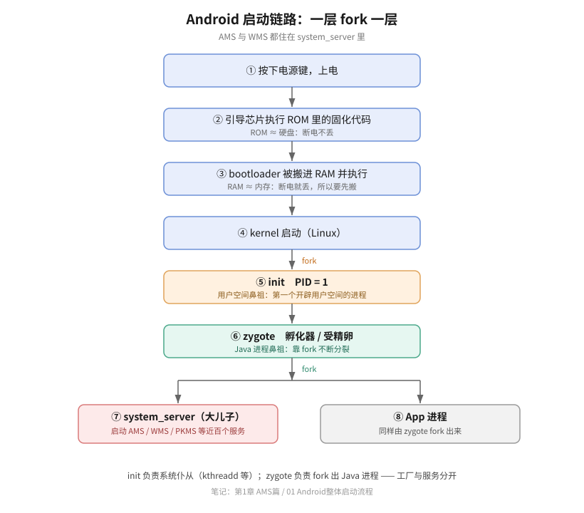

# 01 Android 整体启动流程

> **逐字稿**：`C:\Users\18369\Documents\ZhuangFengYuan\Android面试必问：AMS、WMS核心原理全解析\Android面试必问_AMS、WMS核心原理全解析 - P1 1.Android整体启动流程简析.doc`
> 下一讲：[02 zygote 的启动流程](02-zygote的启动流程.md)
> 导读：[00 导读与规范](../00-导读与规范.md)
> **值得回看**：老师对着**简化的启动链路图**从上电一路走到 App 启动，先把整条链建立起来再看细节
> ⚠️ **文稿口误**：`init` 被写成「阴历 / inlet / unit」，`zygote` 被写成「摘狗 / 摘过 / joke」，`system_server` 被写成「season server / c32位」

---

## 这一讲讲什么

**只做一件事：建立整条启动链的骨架。**

上电 → `init` → `zygote` → `system_server` → `App`。四层，每一层"生出"下一层。

> **记住这张图，后面 12 讲都是往这张图上挂细节。**

---

## 一、从按下电源键到内核启动

| 步   | 谁                  | 做了什么                               | 在哪种介质里跑   |
| --- | ------------------ | ---------------------------------- | --------- |
| 1   | **引导芯片**（Boot [ROM](../00-术语表.md#rom)） | 上电就开始执行 **ROM 里固化的那一小段代码**         | ROM（断电不丢） |
| 2   | 引导芯片               | 把 **bootloader** 从 ROM 加载到 **[RAM](../00-术语表.md#ram)** | 搬运过程      |
| 3   | **bootloader**     | 在 RAM 里执行，然后启动操作系统（kernel）         | RAM       |
| 4   | **kernel**         | 启动**第一个进程 `init`**                 | RAM       |

### 1.1 ROM 和 RAM 的差别（老师特意对比了）

|         | 类比      | 断电后      |
| ------- | ------- | -------- |
| **ROM** | 硬盘 / 磁盘 | **数据还在** |
| **RAM** | 内存      | **数据丢失** |

> 所以启动必须"**从断电不丢的地方（ROM）搬到断电就丢的地方（RAM）**"再执行。

> ⚠️ **先把"ROM"这个词掰清楚** —— 老师这段里它指了两个不同的东西，混了就全乱：

| 叫法 | 到底是什么 | 能就地执行（XIP） | 装什么 |
|---|---|---|---|
| **BootROM**（引导芯片的 ROM） | SoC **内部掩膜 ROM**，出厂固化、**不可改写** | ✅ **能**（片上、随机寻址） | 一级引导固件，几十 KB |
| **启动介质**（boot device） | **eMMC / UFS / NAND**（少数平台是 SPI NOR） | ❌ 多数**不能** | bootloader、kernel、system 镜像 |
| **RAM**（SRAM / DRAM） | 易失内存 | ✅ 能 | 运行时搬进来的代码 + 数据 |

> - "引导芯片执行 **ROM** 里的代码" → 这里的 ROM = **BootROM**
> - "把 bootloader 从 **ROM** 加载到 RAM"、"ROM 相当于硬盘" → 这里的 ROM = **启动介质**
>
> 手机圈习惯把内部存储叫 "ROM"（刷 ROM = 写 eMMC/UFS），所以这个词天生有歧义。
> **下文所有"从 ROM 搬到 RAM"，都按「启动介质 → RAM」理解。**

#### 补充：为什么"非搬不可"（老师没展开，但面试会追）

上面那句其实只是**描述现象**。真正的原因有三层：

| # | 原因 | 说明 |
|---|---|---|
| **①** | **启动介质不能"就地取指"** | 启动介质多是 **NAND / eMMC / UFS**：按页/块访问，带 ECC、坏块管理、FTL，**CPU 没法逐条指令去寻址**。只有 **NOR Flash** 才支持 XIP（execute in place） |
| **②** | **上电那一刻 DRAM 还不能用** | DRAM 要先初始化（时序训练）。此时 CPU 只有很小的**片上 SRAM**（几十~几百 KB），所以实际是两段式：`BootROM → SPL/Preloader 进 SRAM → SPL 初始化 DRAM → 完整 bootloader 进 DRAM` |
| **③** | **执行不只是取指，还要可写的栈** | 代码跑起来需要**栈、堆、可写全局变量**；**Flash 只读**，当不了栈。整段搬进 RAM 后代码和数据都在可读写空间，最简单统一 |

> ⚠️ **一个最容易说错的点**：**不是"代码必须在 RAM 里才能执行"**。
> **BootROM 里那段一级引导，自己就在 ROM 里原地执行** —— 它才是真正 XIP 的那一个。
> 所以准确说法是：**"BootROM 之后的各级加载器与内核，需要被搬进 RAM 才能执行"**。
>
> 另外"必须搬"是**工程惯例，不是物理铁律**：**NOR Flash + XIP** 的平台上，kernel 是可以就地执行的。

> 📌 想看多级引导的细节（BROM → preloader → LK → kernel 各干什么、为什么 preloader 挂了还能救），
> 见 [在岗学习/Android开机流程](../../../在岗学习/Android开机流程.md)。

---

## 二、init：用户空间的鼻祖

### 2.1 为什么它是"鼻祖"

> **`init` 是第一个开辟用户空间的进程** —— 在它之前的所有进程都运行在**内核态**。

| 空间       | 是什么 | 干什么            |
| -------- | --- | -------------- |
| **内核空间** | 内核层 | 内核代码、驱动        |
| **用户空间** | 应用层 | **执行 App 的代码** |

> 所以 `init` 是**用户空间里的第一个进程**，后面所有用户空间进程都是它的后代。

### 2.2 ⚠️ PID 是几（文稿这里说得含糊）

老师口述里出现过"**进程为零**"的说法，**实际是 `init` 的 PID = 1**。

| 进程         | PID   | 说明                               |
| ---------- | ----- | -------------------------------- |
| **init**   | **1** | 用户空间第一个进程                        |
| `kthreadd` | 2     | 内核线程的父进程                         |
| （PID 0）    | 0     | 内核的 idle / swapper 进程，**不是用户进程** |

> 记 **init = PID 1** 就不会错。

---

## 三、init 之后：分叉

`init` 启动后最重要的动作是**按 `init.rc` 里的配置 fork 出子进程**，其中两个必须知道：

| 子进程            | 作用                            | 要不要深入         |
| -------------- | ----------------------------- | ------------- |
| **`kthreadd`** | 内核线程的父进程，处理内核里的工作             | **不用管**（老师原话） |
| **`zygote`**   | **孵化器 / 受精卵**，后面所有 Java 进程的源头 | **重点**        |

---

## 四、zygote：孵化器

### 4.1 名字的由来

`zygote` = 英文 **受精卵**，也叫**孵化器**。

> 老师特意说了这个名字"起得非常好"：**受精卵就是一个单细胞不断分裂**，而 zygote 也是靠 **`fork()` 不断分裂**出进程。

### 4.2 它 fork 出两个关键东西

| 分裂出                 | 说明                            |
| ------------------- | ----------------------------- |
| **`system_server`** | **第一个分裂出来的进程** → 所以叫"**大儿子**" |
| **App 进程**          | 所有应用进程也由 zygote fork 出来       |

### 4.3 为什么说它是「Java 进程的鼻祖」

> **`zygote` 是首次进入 Java 世界的进程。**

它先把自己变成"能跑 Java 的进程"（虚拟机 + 预加载类），之后的 Java 进程都由它 fork —— **子进程天生就是 Java 进程**，不用再初始化一遍。

---

## 五、system_server：大儿子

### 5.1 为什么"大儿子"这么重要

> **因为所有 Java 系统服务，都是在 `system_server` 这个进程里启动的。**

| 在 system_server 里启动的服务 | 管什么                   |
| ---------------------- | --------------------- |
| **[AMS](../00-术语表.md#ams-atm)**                | Activity 管理（本模块第 1 章） |
| **WMS**                | 窗口管理（本模块第 2 章）        |
| **PKMS**               | 包管理                   |
| …以及其余系统服务              |                       |

> **所以 `system_server` 挂了 = 系统服务全挂 = 系统重启（Watchdog 会处理）。**

---

## 六、完整链路（这一讲要背下来的）

**四层，逐层 fork**：

| 层   | 谁               | 生了谁                                 |
| --- | --------------- | ----------------------------------- |
| 1   | `init`（PID 1）   | `kthreadd`（不用管）、**`zygote`**        |
| 2   | **`zygote`**    | **`system_server`**、App 进程          |
| 3   | `system_server` | AMS / WMS / PKMS 等近百个服务（这些不是进程，是服务） |
| 4   | App 进程          | 跑你的 Activity                        |

> 记住"**工厂（zygote）与服务宿主（system_server）分工**"就够了：一个负责 fork，一个负责装服务。

---

## 源码落点

| 环节 | 位置 |
|---|---|
| native 入口：`app_main.cpp` 的 `main()` | [app_main.cpp ↗](https://cs.android.com/android/platform/superproject/main/+/main:frameworks/base/cmds/app_process/app_main.cpp) |
| **`ZygoteInit.main()`**（zygote 进 Java 层） | [ZygoteInit.java:817 ↗](https://cs.android.com/android/platform/superproject/main/+/main:frameworks/base/core/java/com/android/internal/os/ZygoteInit.java;l=817) |
| **`SystemServer.run()`**（启动所有 Java 系统服务） | [SystemServer.java:792 ↗](https://cs.android.com/android/platform/superproject/main/+/main:frameworks/base/services/java/com/android/server/SystemServer.java;l=792) |
| `ActivityThread`（应用进程的入口类） | [ActivityThread.java ↗](https://cs.android.com/android/platform/superproject/main/+/main:frameworks/base/core/java/android/app/ActivityThread.java) |

---

## 易错点

| 易错点                           | 正确理解                                   |
| ----------------------------- | -------------------------------------- |
| 以为 `init` 不是普通进程              | 它是**用户空间的第一个进程，PID 1**                 |
| 以为 ROM 和 RAM 记混               | **ROM 是"硬盘"**（断电不丢）、**RAM 是"内存"**（断电丢） |
| 以为 App 进程是 `system_server` 起的 | **App 进程由 `zygote` fork 出来**           |
| 以为 `system_server` 只是个普通服务    | 它是**所有 Java 系统服务的宿主进程**                |
| 把 `kthreadd` 当成重点             | 内核线程的父进程，**了解即可**                      |

---

## 自检清单

> 用法：不查资料能说出/做到就打勾。勾不上的，箭头指向该去读哪一节。

- [ ] 能背出 **init → zygote → system_server → App** 这条链 → 六
- [ ] 能说清 ROM 和 RAM 的区别，以及为什么要"搬过去再执行" → 1.1
- [ ] 能解释 `init` 为什么叫"用户空间鼻祖"，以及它的 PID → 二
- [ ] 能说出 `init` fork 出的两个关键子进程，以及哪个要重点学 → 三
- [ ] 能解释 `zygote` 为什么叫"受精卵/孵化器" → 4.1
- [ ] 能说出 `system_server` 为什么叫"大儿子"，以及它装了什么 → 五
- [ ] 能解释 `zygote` 为什么被称为"Java 进程的鼻祖" → 4.3

---

## 一句话记忆

> **上电 → bootloader → kernel → `init`(PID 1，用户空间鼻祖) → `zygote`(孵化器，Java 进程鼻祖) → `system_server`(大儿子，装所有 Java 系统服务) + App 进程。**
> 
> **四层链条，每层 fork 下一层；AMS 和 WMS 都住在 `system_server` 里。**
