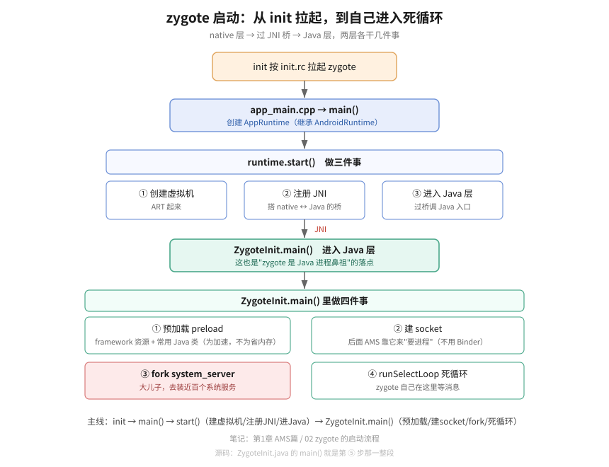

# 02 zygote 的启动流程

> **逐字稿**：`C:\Users\18369\Documents\ZhuangFengYuan\Android面试必问：AMS、WMS核心原理全解析\Android面试必问_AMS、WMS核心原理全解析 - P2 2. zygote的启动流程.doc`
> 上一讲：[01 Android 整体启动流程](01-Android整体启动流程.md)｜下一讲：[03 system_server 进程的创建](03-system_server进程的创建.md)
> 导读：[00 导读与规范](../00-导读与规范.md)
> **值得回看**：老师**逐行翻 Android 11 源码**（`app_main.cpp` → `AndroidRuntime.start` → `ZygoteInit.main`），一路点进 JNI 调 Java 的那一下
> ⚠️ **文稿口误**：`zygote` → 「摘要 / 摘 / 摘口 / s」；`AndroidRuntime` → 「android wrong time / 安卓伊拢汰」；`JNI` → 「gni / ji / JK」；`Binder` → 「band」；`system_server` → 「cs server / c3 server / CN server」

---

## 这一讲讲什么

从 `init` 启动 `zygote` 开始，跟到它进入死循环等消息为止。

**一句话主线**：

```
app_main.cpp(main) → 初始化 AndroidRuntime → start()
   → ① 创建虚拟机 → ② 注册 JNI → ③ 进入 Java 层
   → ZygoteInit.main(): 预加载 → 建 socket → fork system_server → 死循环
```

中间夹着**四道面试题**，这一讲的含金量就在这里。

---

## 一、开场那道题：进程和虚拟机，谁包含谁？

> **老师开场就问**：是一个进程里包了一个虚拟机，还是一个虚拟机里包了很多进程？

**答案：一个进程里包一个虚拟机。进程的概念更大。**

**从源码里看出来的**：`runtime.start()` 里"**创建虚拟机**"这一步，是在**当前进程内部**执行的 —— 虚拟机是这个进程启动出来的运行时环境。

### 1.1 那为什么要"一进程一虚拟机"（**面试题**）

| 论点 | 说明 |
|---|---|
| **进程的定义** | **操作系统分配资源的最小单位** → 每个进程的**内存是私有的** |
| **虚拟机的职责** | 最主要就是**管理内存** |
| **所以要配对** | 进程内存私有 → 一个虚拟机只管本进程的内存，**管理起来最方便** |
| **符合沙盒机制** | 一个进程挂了**不影响**其他进程 |

> 反过来想：如果两个独立内存的进程共用一个虚拟机来管内存，那才叫难管。

---

## 二、native 层：从 init 到"进入 Java 之前"

### 2.1 入口

`zygote` 由 `init` 拉起，执行的 native 入口是 **`app_main.cpp` 的 `main()`**（课程看的是 **Android 11** 源码）。

### 2.2 main 里的核心动作

```cpp
// 伪代码，保留关键顺序
AppRuntime runtime;      // ① 创建 AndroidRuntime 对象
runtime.start(...);      // ② 启动运行时
```

- **`AppRuntime` 继承自 `AndroidRuntime`**（C++ 里的"继承"，和 Java 语法不同但概念一样）
- 老师特意说：**看得懂 C++ 对读 AOSP 帮助很大**，这也是为什么 NDK / C++ 值得学

### 2.3 `runtime.start()` 干三件事（**要背**）

| # | 做什么 | 意义 |
|---|---|---|
| **①** | **创建虚拟机** | 这个进程从此有了 Java 运行环境（ART） |
| **②** | **注册 JNI** | 建好 **native ↔ Java 的桥** |
| **③** | **进入 Java 层** | 通过 JNI 调 Java 的入口方法 |

---

## 三、为什么必须用 JNI 才能"进 Java 层"（**面试题**）

### 3.1 事实

进 Java 层那一行，等价于：

> **用 JNI 调用 `ZygoteInit` 的 `main()` 方法。**

`start()` 里传入的 `startClass` 参数，就是 **`ZygoteInit` 的全类名**；代码拿到它的 `Method` 对象后调用。

### 3.2 为什么非要用 JNI

| 事实 | 推论 |
|---|---|
| 从**上电到此刻**，代码一直跑在**内核层 / native 层** | 从来没有执行过 Java 代码 |
| 要进 Java 层，需要**一个入口** + **一座桥** | 入口 = `ZygoteInit.main()`；桥 = **JNI** |

> **这就是"zygote 是 Java 进程鼻祖"的真正原因**：它是**第一个跨过这座桥**的进程。
> 后面的应用进程都是 fork 它，**天生就在 Java 层**，不用再过桥。

---

## 四、Java 层：`ZygoteInit.main()` 干四件事

| # | 做什么 | 说明 |
|---|---|---|
| **①** | **预加载信息**（`preload`） | 加载 **framework 资源** + **常用 Java 类** |
| **②** | **创建 socket** | 后面 fork 应用进程时，靠它做进程间通信 |
| **③** | **fork 出 `system_server`** | 就是下一讲的"大儿子" |
| **④** | **进入死循环**（`runSelectLoop`） | 等 AMS 发消息来"要一个进程" |

### 4.1 预加载到底为了什么（**易错点**）

> **作用：加快应用进程的启动速度。**
> **不是节省内存。**

为什么不能简单说"省内存"：

- fork 是把父进程的**地址空间复制**给子进程
- 但用的是 **写时拷贝（copy-on-write）**：**不修改就不真的复制**
- 所以严格说：**大部分共享，只有改动的那部分才复制** —— 有一点省的成分，但**主要收益是"省掉重新加载的时间"**

> 老师原话的意思是：**面试时说"省内存"一般算错，除非你能把写时拷贝讲清楚。**

### 4.2 为什么用 socket 而不是 Binder（**面试题**）

| 原因 | 说明 |
|---|---|
| **① Binder 还没准备好** | 此刻 Binder 机制尚未初始化完成 |
| **② 更关键：fork 与多线程不兼容** | **Binder 是多线程机制**；fork 只复制调用线程，**其他线程在子进程里不存在** |
| **→ 后果** | 父进程里被某线程持有的锁，在子进程里**永远不会被解开** → **死锁** |

> 所以 zygote 与"要进程的人"之间用**单线程的 socket** 通信，避开这个坑。

---

## 五、为什么是 zygote 来 fork 应用进程（**面试题**）

> 既然要 fork，为什么不让 `init` 或 `system_server` 来干？

### 5.1 不放在 `init` 里

在设备上看进程表（`pid` / `ppid` / 进程名三列）：

- `init` 的 pid = 1，**ppid = 0**
- **ppid = 1 的进程一大堆** —— 说明 `init` 已经 fork 了**很多**东西

> `init` 负责创建的东西**应用进程根本不需要**，让它再管应用进程既臃肿又没意义。
> 附带一条：**虚拟机是在 zygote 里才创建的**，`init` 阶段还没有。

### 5.2 不放在 `system_server` 里

`system_server` 里**确实**有虚拟机，但：

| 事实 | 推论 |
|---|---|
| 它要启动**接近 100 个**系统服务（AMS/WMS/PKMS…） | 服务负载重 |
| 这些服务**全系统公用**，只要一份 | **不需要**每个应用进程里再来一套 |
| 应用通过**进程间通信**访问它们即可 | 没必要共享进程 |

> 一句话：**`system_server` 是"服务之家"，不是"进程工厂"**。工厂交给 zygote。

---

## 六、串起来的完整流程



**主线一句话**：`init` → `main()` → `start()`（建虚拟机 / 注册 JNI / 进 Java）→ `ZygoteInit.main()`（预加载 / 建 socket / fork `system_server` / 死循环）。

### 源码落点

| 环节 | 位置 |
|---|---|
| native 入口：`app_main.cpp` 的 `main()` | [app_main.cpp ↗](https://cs.android.com/android/platform/superproject/main/+/main:frameworks/base/cmds/app_process/app_main.cpp) |
| `AndroidRuntime.start()`（建虚拟机、注册 JNI、过桥） | [AndroidRuntime.cpp ↗](https://cs.android.com/android/platform/superproject/main/+/main:frameworks/base/core/jni/AndroidRuntime.cpp) |
| **`ZygoteInit.main()`**（预加载 / socket / fork / 死循环） | [ZygoteInit.java:817 ↗](https://cs.android.com/android/platform/superproject/main/+/main:frameworks/base/core/java/com/android/internal/os/ZygoteInit.java;l=817) |

---

## 易错点

| 易错点 | 正确理解 |
|---|---|
| 说"虚拟机比进程大" | **进程更大**：一个进程里包一个虚拟机 |
| 说预加载是为了"省内存" | 主要为了**加快启动**；省内存要讲写时拷贝才成立 |
| 以为 zygote 用 Binder 通信 | 用 **socket**（Binder 未就绪 + fork 与多线程冲突会死锁） |
| 以为应用进程由 `system_server` fork | 由 **zygote** fork |
| 以为 JNI 只是"调 C 代码用" | 这里它是 **native 进 Java 的入口桥梁** |
| 把 `system_server` 写成 `SystemServer` 搞混 | 进程名是小写 `system_server`，类名是 `SystemServer`，**指同一个东西** |

---

## 自检清单

> 用法：不查资料能说出/做到就打勾。勾不上的，箭头指向该去读哪一节。

- [ ] 能回答"进程和虚拟机谁包含谁"，并说出源码里的依据 → 一
- [ ] 能说出"一进程一虚拟机"的**四个理由** → 1.1
- [ ] 能背出 `runtime.start()` 的三件事 → 2.3
- [ ] 能解释为什么进 Java 层必须靠 JNI（入口 + 桥） → 三
- [ ] 能背出 `ZygoteInit.main()` 的四件事 → 四
- [ ] 能说清预加载的真实收益，以及为什么不能说"省内存" → 4.1
- [ ] 能说出用 socket 而不用 Binder 的**两个原因** → 4.2
- [ ] 能回答"为什么不让 init / system_server 来 fork 应用进程" → 五

---

## 一句话记忆

> **zygote 启动 = 建虚拟机 → 注册 JNI → 过桥进 Java → 预加载 + 建 socket + fork system_server + 死循环等消息。**
>
> **四道面试题**：进程包虚拟机（内存私有好管理）/ 预加载是为快不是省 / socket 避开 fork 死锁 / 工厂归 zygote、服务归 system_server。
