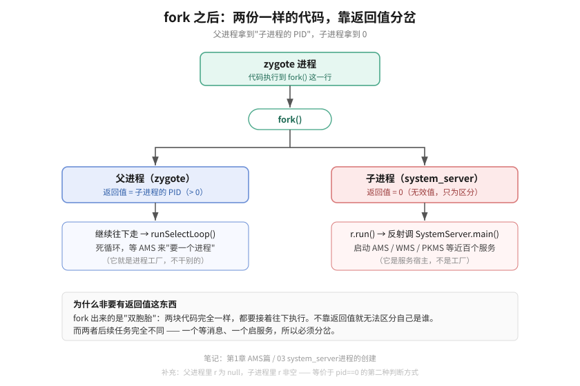

# 03 system_server 进程的创建

> **逐字稿**：`C:\Users\18369\Documents\ZhuangFengYuan\Android面试必问：AMS、WMS核心原理全解析\Android面试必问_AMS、WMS核心原理全解析 - P3 3.system_server进程的创建.doc`
> 上一讲：[02 zygote 的启动流程](02-zygote的启动流程.md)｜下一讲：[04 ATM 和 AMS 的启动流程](04-ATM和AMS的启动流程.md)
> 导读：[00 导读与规范](../00-导读与规范.md)
> **值得回看**：老师**在纸上画图**演示 fork 前是"一个细胞"、fork 后变"两个一模一样的细胞"，以及 CPU 逐行执行到 fork 那一行的瞬间

---

## 这一讲讲什么

`zygote` fork 出 `system_server` 之后，**两个进程的代码一模一样** —— 那怎么知道自己是父还是子？

**答案：看 `fork()` 的返回值。** 这一讲就围绕这一行展开。

```java
pid = Zygote.forkSystemServer(...);
if (pid == 0) {
    // 子进程：system_server 走这里
    handleSystemServerProcess(...);
}
// 父进程：zygote 继续往下走 → runSelectLoop 死循环
```

---

## 一、fork 的返回值规则（**这一讲的核心**）

| 在哪 | `fork()` 返回什么 | 含义 |
|---|---|---|
| **父进程** | **子进程的 PID**（> 0） | "我生了一个 PID 是 xxx 的孩子" |
| **子进程** | **0** | "我是被生出来的那个"（0 是**无效值/占位**，没有实际含义） |

> 老师原话的意思：**这个返回值不是"有理由的设计"，而是 `fork` 这个函数本身的约定** —— 它的存在就是为了让两个进程**能区分自己是谁**。

### 1.1 为什么必须能区分

fork 之后是"**双胞胎**"：两块**完全一样**的代码，都要接着往下执行。但它们的**任务不同**：

| 进程 | 接下来干什么 |
|---|---|
| **父进程（zygote）** | 回到 `runSelectLoop`，**死循环等消息**（等有人来"要进程"） |
| **子进程（system_server）** | 去**启动 [AMS](../../../辅助稿/术语表.md#ams-atm) / WMS / PKMS 等近百个系统服务** |

> 如果分不出来，"启动服务的那个进程"和"等消息的那个进程"就混在一起了。

### 1.2 类比（老师用的）

受精卵分裂成两个细胞 → 两个细胞**看起来一样**，但后续**分裂方向不同**。fork 也是：复制出两份，然后**各走各的路**。

---

## 二、`system_server` 是怎么被拉起来的

### 2.1 调用链

```
ZygoteInit.main()
   ↓
forkSystemServer()            ← 执行 fork
   ↓
if (pid == 0)                 ← 子进程分支
   ↓
handleSystemServerProcess()   ← 处理"子进程该干什么"
   ↓
拿到一个 Runnable r
   ↓
r.run()                       ← 真正的启动动作在这里
```

### 2.2 为什么返回的是一个 `Runnable`

`forkSystemServer` 的返回值不是一个"进程对象"，而是**一个 `Runnable`**。

> 关键在于：**它只在子进程里被创建**（因为在 `if (pid == 0)` 分支里），所以在父进程里是 `null`。
>
> 于是代码用 `r != null` 就能判断"我是不是子进程" —— **这是第二种区分方式，和 `pid == 0` 等价**。

| 进程 | `r` | 后续 |
|---|---|---|
| **子进程** | `Runnable` 对象（非空） | `r.run()` → 启动 system_server |
| **父进程** | **null** | 跳过，走 `runSelectLoop` |

---

## 三、`r.run()` 里做了什么：反射调 `SystemServer.main`

### 3.1 关键手法：反射

```java
// 伪代码
Class<?> cl = Class.forName("com.android.server.SystemServer");
Method main = cl.getMethod("main", String[].class);
// ↓ 注意：这里只是"拿到方法"，还没执行
// 执行放在 run() 里
main.invoke(null, args);
```

**两个步骤要分清**（老师特意强调）：

| 步骤 | 在哪做 |
|---|---|
| **拿到** `Method` 对象 | 创建 `Runnable` 时 |
| **执行** `main` 方法 | `Runnable.run()` 里 |

### 3.2 为什么这里要用反射

> 因为此刻还没法直接 `new SystemServer().main()` —— 它是通过**类名字符串**来定位入口的，反射是"**按名字找方法再调用**"的标准手段。

---

## 四、两条路在这里分开



---

## 五、`system_server` 这个名字（易混）

| 写法 | 是什么 |
|---|---|
| **`system_server`**（小写，下划线） | **进程名**（`ps` 里看到的） |
| **`SystemServer`**（大写，驼峰） | **类名**（`com.android.server.SystemServer`） |

> 老师原话：这两个**指的是同一个东西**，只是"进程名"和"类名"两种写法。

---

## 源码落点

| 环节 | 位置 |
|---|---|
| **`Zygote.forkSystemServer()`** —— fork 在这里发生 | [Zygote.java ↗](https://cs.android.com/android/platform/superproject/main/+/main:frameworks/base/core/java/com/android/internal/os/Zygote.java) |
| `ZygoteConnection.handleSystemServerProcess()` —— 子进程分支 | [ZygoteConnection.java ↗](https://cs.android.com/android/platform/superproject/main/+/main:frameworks/base/core/java/com/android/internal/os/ZygoteConnection.java) |
| **`SystemServer.main()` → `run()`** —— 反射落到这里 | [SystemServer.java:792 ↗](https://cs.android.com/android/platform/superproject/main/+/main:frameworks/base/services/java/com/android/server/SystemServer.java;l=792) |

> 看 `forkSystemServer` 时重点找 **`pid == 0`** 那个分支——它就是"我是子进程"的判定。

---

## 易错点

| 易错点 | 正确理解 |
|---|---|
| 以为子进程的 `fork` 返回值是"自己的 PID" | 子进程返回 **0**；父进程返回**子进程的 PID** |
| 以为返回 0 有特殊含义 | 0 就是个**无效值/占位**，只为区分 |
| 以为 `r.run()` 只是"跑个线程" | 它是在**子进程**里执行 `SystemServer.main()` |
| 把反射"拿到 Method"当成"已经执行" | **拿到是拿到，执行在 `run()` 里** |
| 把 `system_server` 和 `SystemServer` 当两个东西 | 一个是进程名、一个是类名，**同一个** |
| 以为父子进程 fork 后代码不同 | **fork 出来的代码一模一样**，靠返回值分岔 |

---

## 自检清单

> 用法：不查资料能说出/做到就打勾。勾不上的，箭头指向该去读哪一节。

- [ ] 能说出 `fork()` 在父进程和子进程里**分别返回什么** → 一
- [ ] 能解释为什么必须能区分父子进程（两者任务不同） → 1.1
- [ ] 能说出 `pid == 0` 和 `r != null` 是**同一件事的两种判断** → 2.2
- [ ] 能背出从 `forkSystemServer` 到 `r.run()` 的调用链 → 2.1
- [ ] 能说清反射"拿 Method"和"执行 main"**分别在哪一步** → 三
- [ ] 能画出 fork 之后父子两条路的分岔图 → 四
- [ ] 能分清 `system_server`（进程名）和 `SystemServer`（类名） → 五

---

## 一句话记忆

> **fork 之后两个进程代码一模一样，靠返回值分岔：父进程拿到子进程 PID，子进程拿到 0。**
>
> **子进程（`system_server`）→ `r.run()` 里反射调 `SystemServer.main()` 去启动近百个系统服务；父进程（zygote）→ `runSelectLoop` 死循环等消息。**

> 📌 **本篇文稿坑 3 处**：`system_server`、`Zygote`、`pid == 0` —— 见[口误表](../../../辅助稿/口误表.md#03-systemserver-进程的创建)
