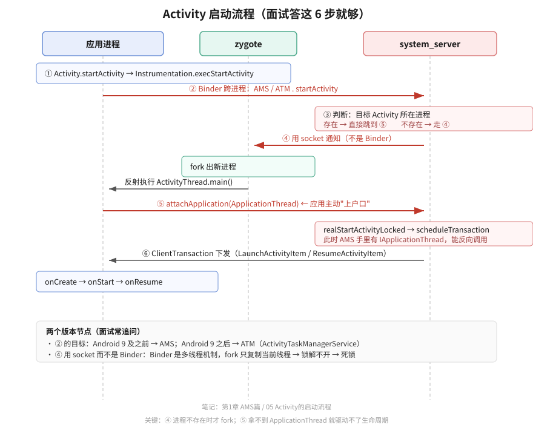

# 05 Activity 的启动流程

> **逐字稿**：`C:\Users\18369\Documents\ZhuangFengYuan\Android面试必问：AMS、WMS核心原理全解析\Android面试必问_AMS、WMS核心原理全解析 - P5 5.Activity的启动流程.doc`
> 上一讲：[04 ATM 和 AMS 的启动流程](04-ATM和AMS的启动流程.md)｜下一讲：[06 Activity 的生命周期和栈管理](06-Activity的生命周期和栈管理.md)
> 导读：[00 导读与规范](../00-导读与规范.md)
> **值得回看**：老师在源码里从 `ActivityThread.main` 一路点到 `attachApplication`，讲"为什么 AMS 必须等应用主动上户口"，还有他答这道面试题时的**完整口述版**
> ⚠️ **文稿口误**：`ActivityThread` → 「activity three / activity s read / activity item」；`ApplicationThread` → 「application three」；`Binder` → 「band/ban」；`Zygote` → 「摘要/摘口的」

---

## 这一讲讲什么

**一道高频面试题：Activity 的启动流程。**

老师反复强调：**这题不是让你背流程图**，而是让你说清 **6 个关键点**。这一讲就按"面试怎么答"来组织。

> 原话大意：几百个方法一个个说，别说你懵，面试官也懵。

---

## 一、面试版答案（**先背这 6 步**）



### 这一讲的源码落点（点行号直接跳）

| 步骤 | 方法 | 位置 |
|---|---|---|
| ② 请求交给系统 | `Instrumentation.execStartActivity()` | [Instrumentation.java ↗](https://cs.android.com/android/platform/superproject/main/+/main:frameworks/base/core/java/android/app/Instrumentation.java) |
| ④ 判断进程 / 走下一环 | `ActivityStarter.executeRequest()` | [ActivityStarter.java:1037 ↗](https://cs.android.com/android/platform/superproject/main/+/main:frameworks/base/services/core/java/com/android/server/wm/ActivityStarter.java;l=1037) |
| ⑥ 应用侧入口 | `ActivityThread.handleLaunchActivity()` | [ActivityThread.java:4385 ↗](https://cs.android.com/android/platform/superproject/main/+/main:frameworks/base/core/java/android/app/ActivityThread.java;l=4385) |
| ⑥ 真正创建 Activity | `ActivityThread.performLaunchActivity()` | [ActivityThread.java:4062 ↗](https://cs.android.com/android/platform/superproject/main/+/main:frameworks/base/core/java/android/app/ActivityThread.java;l=4062) |
| ⑥ 应用"上户口" | `ActivityThread.attach()` → `attachApplication` | [ActivityThread.java ↗](https://cs.android.com/android/platform/superproject/main/+/main:frameworks/base/core/java/android/app/ActivityThread.java) |

> ⚠️ 课程讲的是 **Android 11**，上面指向 **aosp-main**。行号会随版本漂，**方法名不变** —— 找不到就用 `Ctrl+F` 搜方法名。

```
① 不管从哪发起，最终都走到 Activity.startActivity
        ↓
② → startActivityForResult → Instrumentation.execStartActivity
        ↓
③ 【跨进程】通过 Binder 进入 AMS / ATM 的 startActivity
      · Android 9 及之前：进 AMS
      · Android 9 之后：  进 ATM
      · 跨进程前先用 ServiceManager 拿到服务代理（代理模式）
        ↓
④ AMS/ATM 判断：目标 Activity 所在进程【是否已存在】
        ↓
  存在 → 直接 realStartActivityLocked
  不存在 → ⑤ 用 socket 通知 zygote，fork 出新进程
                    ↓
              zygote 反射调 ActivityThread.main()
        ↓
⑥ 新进程通过 attachApplication 把 ApplicationThread(Binder) 交给 AMS
      → AMS 从此能反向驱动这个进程的生命周期（onCreate/onStart/onResume）
```

> **这 6 步说清楚，这题就算答住了。** 细节方法名说不上来没关系。

---

## 二、逐段展开

### 2.1 第①段：所有启动殊途同归

| 启动来源 | 也都走这里 |
|---|---|
| Launcher 点击图标 | ✅ |
| Activity A 启动 Activity B | ✅ |
| 其他（Service 拉起等） | ✅ |

**统一入口**：`Activity.startActivity()`

---

### 2.2 第②段：从 Activity 到 Instrumentation

```
Activity.startActivity()
   ↓
Activity.startActivityForResult()
   ↓
Instrumentation.execStartActivity()      ← 这里是"真正要去求系统了"
```

> `Instrumentation` 是**应用进程内**的中转站，负责"把请求交给系统"。

---

### 2.3 第③段：跨进程进入 AMS / ATM（**版本分界线**）

| 版本 | 目标 |
|---|---|
| **Android 9 及之前** | **AMS**.`startActivity()` |
| **Android 9 之后**（含 10/11） | **ATM**（`ActivityTaskManagerService`）`.startActivity()` |

**两个必须说出来的点**：

| 点 | 说明 |
|---|---|
| **这是跨进程调用** | 用 **Binder** |
| **AMS/ATM 是怎么拿到的** | 通过 **`ServiceManager`** 获取 —— 这里用了**代理模式**（拿到的是 Binder 代理对象） |

> 老师借这个点延伸：**面试问设计模式，能答"源码里哪儿用了"比背定义值钱**。

---

### 2.4 第④段：ATT 内部继续走（细节可跳过）

```
ATM.startActivity()
   ↓ startActivityAsUser()
   ↓ ActivityStarter.execute()
   ↓ executeRequest()
   ↓ startActivityInner()          ← 这里判断启动模式、栈
   ↓ 【关键判断：进程是否存在】
```

---

### 2.5 第⑤段：进程不存在 → 让 zygote 干活

**调用链**：

```
AMS.startProcessLocked()
   ↓
Process.start()                        ← 应用侧发起
   ↓
ZygoteProcess.startViaZygote()
   ↓ 打开 socket（客户端）
ZygoteProcess.zygoteSendArgsAndGetResult()   ← 写数据过去
   ↓
zygote 收到 → fork 出新进程
   ↓
新进程通过【反射】执行 ActivityThread.main()
```

**两个要点**：

| 要点 | 说明 |
|---|---|
| **为什么用 socket 而不是 Binder** | 见 [02 讲](../第1章-AMS篇/02-zygote的启动流程.md)：Binder 是多线程机制，**fork 会死锁** |
| **fork 之后怎么起来的** | 和 `system_server` 一样：**反射调 main 方法** |

> 老师原话：面试被问"进程怎么 fork 出来的"，能答"**AMS 通过 socket 通知 zygote 去 fork**"就够了。

---

### 2.6 第⑥段：**最关键的一步** —— 应用主动"上户口"

**问题**：AMS 要管理新进程的 Activity 生命周期，它得有办法**反向调用**这个进程 —— 这个"句柄"从哪来？

> **答案：由应用自己交给 AMS。** 类比新生儿**上户口** —— 你不登记，人口系统就不知道你存在。

**怎么交**：

```
ActivityThread.main()
   ↓
attach(false)                              // false = 非系统进程
   ↓
ActivityManager.getService()               // 跨进程拿到 AMS
   ↓
attachApplication(mAppThread)              // 把 Binder 交给 AMS
```

**`mAppThread` 是什么**：`ApplicationThread` —— 它是一个 **Binder 服务**，实现了 `IApplicationThread`。

| 方向 | 用什么 |
|---|---|
| 应用 → AMS | `IActivityManager` 的 Binder 代理 |
| **AMS → 应用** | **`IApplicationThread`**（即 `ApplicationThread`） |

> **拿到这个 Binder 之后，AMS 才能 `scheduleTransaction` 一路把 `onCreate/onStart/onResume` 推到应用进程里执行。**

**反向验证**：`LaunchActivityItem.execute()` 里调的 `client.scheduleTransaction(...)`，`client` 就是 `ApplicationThread` 的代理。

---

## 三、整条链路

> **完整时序图见本讲开头**：[Activity 启动时序](.img/02-Activity启动时序.svg)。需要文字版就回到 §一 的 6 步。
>
> 这里原来那版 ASCII 泳道图已移除 —— 中英混排时 `│`、`└` 和空格对不齐，反而比图更难看清。

---

## 四、老师的额外提醒

| 提醒 | 说明 |
|---|---|
| **别背流程图** | 几百个方法记不住；记**6 个关键点**即可 |
| **平时要画流程图/时序图** | 老师自己两三个月不看也会忘，靠图恢复 |
| **"学了就忘"分两种** | ① 明天就忘 = 没理解，在死记；② 两三个月忘 = 正常，捡起来很快 |
| **看源码的目的是解决问题** | 不是为了看完；遇到 bug 带着问题看，才知道哪是重点 |

---

## 易错点

| 易错点 | 正确理解 |
|---|---|
| 以为 Android 全版本都是进 AMS | **Android 9 之后进 ATM** |
| 以为 AMS 主动就能管到应用进程 | 必须等应用 `attachApplication` **上户口** |
| 搞反两个 Binder 方向 | 应用→AMS 用 `IActivityManager`；**AMS→应用用 `IApplicationThread`** |
| 以为 fork 是 Binder 通知 zygote | 是 **socket**（fork 与 Binder 多线程冲突） |
| 以为 fork 后自动就有 Activity | 还要 `ActivityThread.main()` + `attach` 才进流程 |
| 面试时从头到尾报方法名 | **说 6 个关键点**，细节可跳过 |

---

## 自检清单

> 用法：不查资料能说出/做到就打勾。勾不上的，箭头指向该去读哪一节。

- [ ] 能不卡壳地说出**面试版 6 步** → 一
- [ ] 能说出统一入口和 `Instrumentation` 的位置 → 2.1 / 2.2
- [ ] 能说出 **Android 9 前后跨进程目标的变化**（AMS → ATM） → 2.3
- [ ] 能说出 AMS/ATM 是**通过 `ServiceManager` 拿到的**（代理模式） → 2.3
- [ ] 能说出进程不存在时是**通过 socket 通知 zygote** → 2.5
- [ ] 能解释 AMS 为什么要等应用 `attachApplication`（上户口类比） → 2.6
- [ ] 能分清 `IActivityManager` 和 `IApplicationThread` 两个方向 → 2.6

---

## 一句话记忆

> **startActivity → Instrumentation.execStartActivity →（Binder）AMS/ATM → 判进程在不在 → 不在就让 socket 通知 zygote fork → 新进程反射跑 ActivityThread.main → attachApplication 交出 ApplicationThread → AMS 驱动生命周期。**
>
> **面试只答 6 点：统一入口 / Instrumentation / 跨进程进 AMS·ATM（9 是分界） / 判进程 / socket 找 zygote / 应用主动上户口。**
