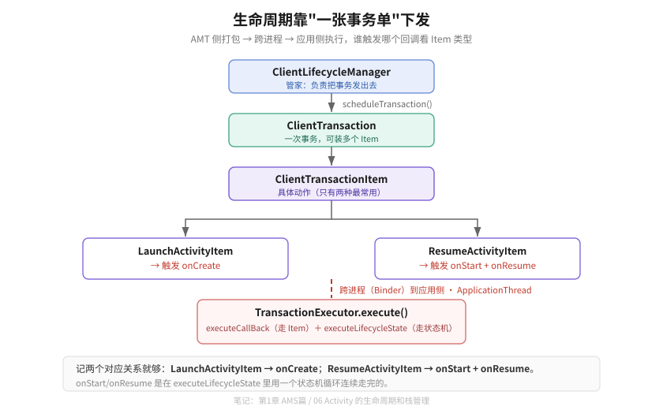

# 06 Activity 的生命周期和栈管理

> **逐字稿**：`C:\Users\18369\Documents\ZhuangFengYuan\Android面试必问：AMS、WMS核心原理全解析\Android面试必问_AMS、WMS核心原理全解析 - P6 6.Activity的生命周期和栈的管理.doc`
> 上一讲：[05 Activity 的启动流程](05-Activity的启动流程.md)
> 导读：[00 导读与规范](../00-导读与规范.md)
> **值得回看**：老师**在白板画生命周期管理的类图**（ClientLifecycleManager → [ClientTransaction](../../../辅助稿/术语表.md#clienttransaction) → Item），以及现场跑 `dumpsys activity` 看栈信息

---

## 这一讲讲什么

上半讲：**[AMS](../../../辅助稿/术语表.md#ams-atm) 拿到 `ApplicationThread` 之后，怎么把 `onCreate/onStart/onResume` 推过来执行**（生命周期管理的类图）。

下半讲：**栈管理**（`ActivityRecord` / `Task` / `ActivityStack`），以及怎么用 `dumpsys activity` 看它。

---

## 一、生命周期管理：三个类就够了（**必须记住的类图**）



| 类 | 干什么 | 谁触发哪个生命周期 |
|---|---|---|
| **`ClientLifecycleManager`** | 统一管理生命周期事务的下发 | — |
| **`ClientTransaction`** | 一次"事务"，可携带多个 item | — |
| **`LaunchActivityItem`** | 启动/创建 | **`onCreate`** |
| **`ResumeActivityItem`** | 恢复 | **`onStart` + `onResume`** |

> **记忆点**：`onCreate` 归 `LaunchActivityItem`；`onStart/onResume` 归 `ResumeActivityItem`。

---

## 二、下发路径（从 AMS 到应用进程）

```
realStartActivityLocked()
   ↓
获取 ClientLifecycleManager
   ↓
scheduleTransaction(transaction)
   ↓
ClientTransaction.schedule()
   ↓ 【跨进程 Binder】
ApplicationThread.scheduleTransaction()      ← 到了应用进程
   ↓
进入 Handler 流程
   ↓
TransactionExecutor.execute(transaction)
```

### 2.1 一个版本变更点

> **Android 9 起，这块 [Handler](../../../辅助稿/术语表.md#handler) 流程用「状态模式」重写了** —— 不同状态对应不同处理方法。

---

## 三、`TransactionExecutor.execute()` 里做什么（关键）

`execute()` 里最重要是**两个动作**：

| 动作 | 干什么 |
|---|---|
| **`executeCallBack`** | 执行事务里的 **item**（如 `LaunchActivityItem`）→ 走到 `handleLaunchActivity` → **`onCreate`** |
| **`executeLifecycleState`** | 走到 `handleStartActivity` / `handleResumeActivity` |

### 3.1 `executeLifecycleState` 里的那个 for 循环（细节但漂亮）

```java
// 伪代码
for (state = ON_START; ; state = nextState) {
    switch (state) {
        case ON_START:  → handleStartActivity()    // onStart
        case ON_RESUME: → handleResumeActivity()   // onResume
    }
    if (state == ON_RESUME) break;
}
```

> **靠状态推进，一次循环把 `onStart` 和 `onResume` 都走完。**

---

## 四、栈管理：三个对象

| 对象 | 是什么 | 对应关系 |
|---|---|---|
| **`ActivityRecord`** | 一个 Activity 在 AMS 里的**记录**（把它的信息全存下来） | **一个 Activity ↔ 一个 ActivityRecord** |
| **`Task`**（Android 11 前叫 **`TaskRecord`**） | 任务栈，管理**多个 ActivityRecord** | **一个 Task 装多个 ActivityRecord** |
| **`ActivityStack`** | 更高一层，管理多个 Task | 老师提到有 **home stack / focused stack** 等类型（⚠️ 具体类名以源码为准） |

`ActivityStack` → **`Task`**（多个）→ **`ActivityRecord`**（多个，一个对应一个 Activity）

> ⚠️ **版本变化**：Android 11 里 `TaskRecord` **改名成了 `Task`**。

---

## 五、怎么"看见"栈：`dumpsys activity`

```bash
adb shell dumpsys activity
```

输出里能看到 **ActivityRecord / TaskRecord（Task）** 的信息 —— 这就是 AMS 眼里"当前系统里有什么栈、什么 Activity"。

**这项技能能解决的问题**：

| 现象 | 用栈信息能看出什么 |
|---|---|
| 多次启动后**栈溢出** | Task 里堆了多少 ActivityRecord |
| 明明推到后台却又被**拉起** | 哪个 task 变到前台了 |
| 页面栈错乱 | Task 的层级和归属 |

> 老师原话：这块平时"没事多看看"，排障很有用。

---

## 六、为什么要熟悉启动流程：插件化

> **"启动一个没在 AndroidManifest 里注册的 Activity"** —— 这就是**插件化**的核心。

用到的东西（老师在这是"串知识网"）：

| 需要什么 | 在哪学 |
|---|---|
| **AMS 启动流程** | 本模块第 1 章 |
| 包管理（PMS） | 另一块 |
| **类加载流程** | Java / JVM |
| **资源加载流程** | 资源系统 |
| 反射 / 动态代理 | Java |

> **知识点不是零散的**：学会后要连成网。老师原话大意——面试时不是"面试官问一句你答一句"，而是**能从一个点发散出去**。

---

## 源码落点

| 环节 | 位置 |
|---|---|
| `ClientLifecycleManager`（下发事务） | [ClientLifecycleManager.java ↗](https://cs.android.com/android/platform/superproject/main/+/main:frameworks/base/services/core/java/com/android/server/wm/ClientLifecycleManager.java) |
| `ClientTransaction`（一次事务） | [ClientTransaction.java ↗](https://cs.android.com/android/platform/superproject/main/+/main:frameworks/base/services/core/java/com/android/server/wm/ClientTransaction.java) |
| **`LaunchActivityItem`** → `onCreate` | [LaunchActivityItem.java ↗](https://cs.android.com/android/platform/superproject/main/+/main:frameworks/base/services/core/java/com/android/server/wm/LaunchActivityItem.java) |
| **`ResumeActivityItem`** → `onStart` + `onResume` | [ResumeActivityItem.java ↗](https://cs.android.com/android/platform/superproject/main/+/main:frameworks/base/services/core/java/com/android/server/wm/ResumeActivityItem.java) |
| `TransactionExecutor.execute()`（应用侧执行） | [TransactionExecutor.java ↗](https://cs.android.com/android/platform/superproject/main/+/main:frameworks/base/services/core/java/com/android/server/wm/TransactionExecutor.java) |
| `ActivityRecord` / `Task`（栈的两层） | [ActivityRecord ↗](https://cs.android.com/android/platform/superproject/main/+/main:frameworks/base/services/core/java/com/android/server/wm/ActivityRecord.java) ｜ [Task ↗](https://cs.android.com/android/platform/superproject/main/+/main:frameworks/base/services/core/java/com/android/server/wm/Task.java) |

> 看 `TransactionExecutor.execute()` 时找 **`executeCallBack`** 和 **`executeLifecycleState`** 两个方法名，就是"走 Item"和"走状态机"的分界。

---

## 易错点

| 易错点 | 正确理解 |
|---|---|
| 以为 `onCreate` 和 `onResume` 由同一个 item 触发 | `LaunchActivityItem` → onCreate；`ResumeActivityItem` → onStart + onResume |
| 以为 `ClientTransaction` 只能装一个 item | 它可以**装多个** |
| 以为 `TaskRecord` 一直叫这名字 | **Android 11 起叫 `Task`** |
| 把 `ActivityRecord` 和 `Activity` 当同一个 | ActivityRecord 是它在 **AMS 里的记录对象** |
| 以为生命周期是 AMS 直接调用的 | 中间经 **[Binder](../../../辅助稿/术语表.md#binder) → Handler → TransactionExecutor** 一转手 |

---

## 自检清单

> 用法：不查资料能说出/做到就打勾。勾不上的，箭头指向该去读哪一节。

- [ ] 能画出生命周期管理的**三个类**及它们的层次 → 一
- [ ] 能说出 `LaunchActivityItem` 和 `ResumeActivityItem` **各触发哪些生命周期** → 一
- [ ] 能背出从 `scheduleTransaction` 到 `TransactionExecutor` 的路径 → 二
- [ ] 能说出 `execute()` 里的**两个关键动作** → 三
- [ ] 能说出 `ActivityRecord` / `Task` / `ActivityStack` 的包含关系 → 四
- [ ] 知道 Android 11 里 `TaskRecord` 改名成 `Task` → 四
- [ ] 会用 `dumpsys activity` 看栈信息，并说出能解决哪类问题 → 五

---

## 一句话记忆

> **生命周期靠一张事务单：`ClientLifecycleManager` → `ClientTransaction` → `LaunchActivityItem`(onCreate) / `ResumeActivityItem`(onStart+onResume)，经 Binder 到应用进程再由 `TransactionExecutor` 执行。**
>
> **栈三层：`ActivityStack` → `Task`(11 前叫 TaskRecord) → `ActivityRecord`(一个对应一个 Activity)，用 `dumpsys activity` 就能看见。**

> 📌 **本篇文稿坑 4 处**：`ActivityThread`、`ActivityStack`、`dumpsys`、`ResumeActivityItem` —— 见[口误表](../../../辅助稿/口误表.md#06-activity-的生命周期和栈管理)
