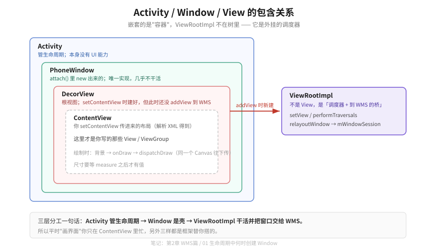
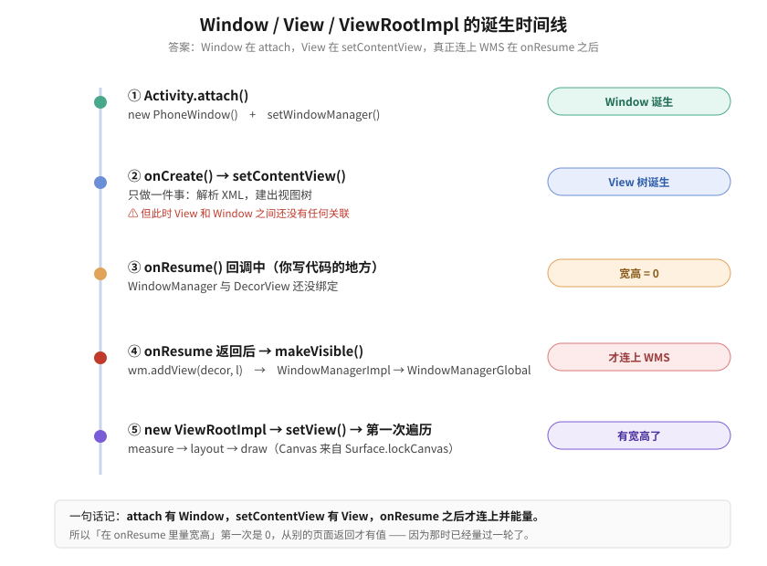

# 01 生命周期中何时创建 Window

> **逐字稿**：`C:\Users\18369\Documents\ZhuangFengYuan\Android面试必问：AMS、WMS核心原理全解析\Android面试必问_AMS、WMS核心原理全解析 - P7 1.activity生命周期中何时创建Window的.doc`
> 下一讲：[02 Window 到底在哪个生命周期创建](02-Window在哪个生命周期创建.md)
> 导读：[00 导读与规范](../00-导读与规范.md)
> **值得回看**：老师开头那段"这张关系图谁都见过，但**它们什么时候建立联系**你答不上来"，以及他现场从 `handleLaunchActivity` 点进 `performLaunchActivity` → `attach`

---

## 这一讲讲什么

**一道"人人都以为自己会"的题**：Activity、Window、View 的关系谁都背得出，但——

> **"Activity 和 Window 是什么时候建立联系的？Window 和 View 又是怎么建立联系的？"**

答不上来，就说明只是背了张图。这一讲给出时间点。

---

## 一、先说清"背得出来的那部分"



**这套关系没错**，问题是：**它们是"什么时候"串起来的？** 图上看不出来。

> 老师的判断很直接：**这不是"面试表达不行"，是理解停在一知半解**。

---

## 二、前提：Android 的一切都是消息

### 2.1 所有生命周期，本质上都是 Handler 的一条消息

> **任何生命周期、任何事件（点击、刷新…）最终都是一个 `Message`。** Android 是**消息驱动**的。

| 在哪里看 | 看到什么 |
|---|---|
| `ApplicationThread`（[Binder](../../../辅助稿/术语表.md#binder) 服务） | 一大堆 `handleXxx` 方法：`handleLaunchActivity`、`handleResumeActivity`… |
| `ApplicationThread` 里还有 | `ApplicationThread` 的 handler 处理生命周期消息 |

> 所以第 1 章讲的那条"[AMS](../../../辅助稿/术语表.md#ams-atm) 通过 `ApplicationThread` 驱动生命周期"的线，**落到应用进程就是"发了一条消息"**。

### 2.2 这一讲的入口消息：`handleLaunchActivity`

```
ActivityThread.handleLaunchActivity()
   ↓
① 初始化 WindowManagerService 的 Binder 引用    ← 注意：在这里就拿到了 WMS
   ↓
② performLaunchActivity()
```

**两个要点**：

| 要点 | 说明 |
|---|---|
| WMS 的 Binder 引用**在这一步初始化** | 后面 `setWindowManager` 才有东西可用 |
| `handleLaunchActivity` 是**消息处理的入口** | 由 AMS 那边的请求触发 |

---

## 三、`performLaunchActivity()`：三件事按顺序发生

```
performLaunchActivity()
   ↓
① 类加载：ClassLoader 把 Activity 类找出来 → newActivity()
   ↓
② activity.attach(...)          ← 【Window 在这里诞生】
   ↓
③ 调 onCreate() → 子类 onCreate → setContentView()   ← 【View 在这里诞生】
```

### 3.1 ① 类加载创建 Activity

> **Activity 对象是通过类加载器 `new` 出来的**（`Instrumentation.newActivity`）。

> 老师顺带一句：**"不注册的 Activity"能不能启动，正是插件化要解决的事**（第 1 章 06 提过）。

### 3.2 ② `attach()` 里发生两件大事（**关键**）

```java
// Activity.attach(...) 内部（伪代码）
mWindow = new PhoneWindow(this, window, activityConfigCallback);   // ★ Window 诞生
mWindow.setWindowManager(wm, mMainThread.getApplicationThread(),
                         getBaseContext().getResources().getDisplayMetrics());
mWindowManager = mWindow.getWindowManager();                       // ★ 有了 WindowManager
```

| 动作 | 意义 |
|---|---|
| **`new PhoneWindow()`** | **Window 对象创建** —— 但此时**还没有任何 View** |
| **`setWindowManager(...)`** | 给 Window 装上 **WindowManager**（这就是 Activity 和窗口系统的连接点） |

> **注意**：`attach` 里**只做了这两件事**，**没有加载任何布局**。

### 3.3 ③ `onCreate` → `setContentView` 才创建 View

```
onCreate()
   ↓ 子类 override 后调用 setContentView(R.layout.xxx)
setContentView()
   ↓
解析 XML → 构建视图树 → 挂到 DecorView 的 ContentView 上
```

> **所以"View 什么时候有的" = `setContentView` 之后。**

---

## 四、时间线（这一讲要的就是这张表）



| 时机 | 谁被创建 | View 有了吗 |
|---|---|---|
| `performLaunchActivity` → 类加载 | **Activity 对象** | ❌ |
| **`activity.attach()`** | **[PhoneWindow](../../../辅助稿/术语表.md#window) + WindowManager** | ❌ **还没有 View** |
| `onCreate()` → **`setContentView()`** | **视图树（[DecorView](../../../辅助稿/术语表.md#decorview-contentview)/ContentView）** | ✅ 有了 |
| `onResume` 之后（第 2、3 讲） | **[ViewRootImpl](../../../辅助稿/术语表.md#viewrootimpl)**（真正连到 WMS） | ✅ + 开始 measure/layout/draw |

> **一句话**：**Window 在 `attach` 就有，View 在 `setContentView` 才有，真正上屏要等 `ViewRootImpl`。**

---

## 五、回答开头那个问题

> **Q：Activity 和 Window 是什么时候建立联系的？**
> **A：在 `activity.attach()` 里 —— 也就是 `onCreate` 之前。** `attach` 里 `new PhoneWindow()` 并 `setWindowManager()`。

> **Q：Window 和 View 什么时候建立联系？**
> **A：`setContentView` 时把视图树挂到 Window 的 DecorView 上。**（第 3 讲讲 ViewRootImpl 时会更完整）

---

## 源码落点（行号直达）

| 时机 | 方法 | 位置 |
|---|---|---|
| ① 消息入口 | `ActivityThread.handleLaunchActivity()` | [ActivityThread.java:4385 ↗](https://cs.android.com/android/platform/superproject/main/+/main:frameworks/base/core/java/android/app/ActivityThread.java;l=4385) |
| ② 类加载建 Activity | `ActivityThread.performLaunchActivity()` | [ActivityThread.java:4062 ↗](https://cs.android.com/android/platform/superproject/main/+/main:frameworks/base/core/java/android/app/ActivityThread.java;l=4062) |
| **③ Window 诞生** | `Activity.attach()` 里 `new PhoneWindow(...)` | [Activity.java:8937 ↗](https://cs.android.com/android/platform/superproject/main/+/main:frameworks/base/core/java/android/app/Activity.java;l=8937) |
| **④ View 诞生** | `Activity.setContentView(View)` | [Activity.java:3906 ↗](https://cs.android.com/android/platform/superproject/main/+/main:frameworks/base/core/java/android/app/Activity.java;l=3906) |

> `attach()` 里除了 `new PhoneWindow`，还有一行 `mWindow.setWindowManager(...)` —— 那是 Activity 和窗口系统接上线的第一下。

---

## 易错点

| 易错点 | 正确理解 |
|---|---|
| 以为 `setContentView` 才创建 Window | **`attach()` 里就 `new PhoneWindow()` 了**，比 `onCreate` 还早 |
| 以为 `attach` 里会加载布局 | `attach` **只创建 Window + 设 WindowManager**，不碰布局 |
| 以为 `onCreate` 里就有 View | 要等 `setContentView` **执行完**才有 |
| 以为生命周期是直接函数调用 | 每一条都是 **[Handler](../../../辅助稿/术语表.md#handler) 的消息** |
| 以为 WMS 引用是后面才拿的 | `handleLaunchActivity` **一开始**就初始化了 |

---

## 自检清单

> 用法：不查资料能说出/做到就打勾。勾不上的，箭头指向该去读哪一节。

- [ ] 能用一句话指出"关系图"回答不了的那个问题是什么 → 这一讲讲什么
- [ ] 能说出 Android 的生命周期在本质上是**什么形式** → 二
- [ ] 能背出 `handleLaunchActivity` 里的**两件事** → 2.2
- [ ] 能说出 `performLaunchActivity` 的**三步顺序** → 三
- [ ] 能指出 **Window 在 `attach` 里创建**，且此时还没有 View → 3.2
- [ ] 能指出 **View 在 `setContentView` 时创建** → 3.3
- [ ] 能默写"谁在什么时候创建"的时间线表 → 四

---

## 一句话记忆

> **Activity 通过类加载创建 → `attach()` 里 `new PhoneWindow()` + `setWindowManager()`（Window 诞生）→ `onCreate` 里 `setContentView` 解析 XML（View 诞生）。**
>
> **所以：Window 比 View 早，两者都比 `ViewRootImpl` 早；而这一整套都由 Handler 的一条消息驱动。**
