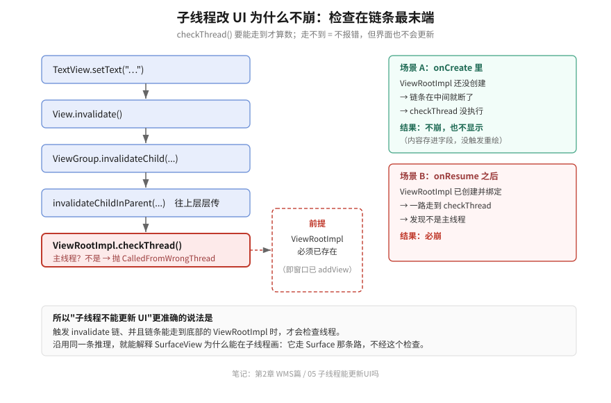

# 05 子线程能更新 UI 吗

> **逐字稿**：`C:\Users\18369\Documents\ZhuangFengYuan\Android面试必问：AMS、WMS核心原理全解析\Android面试必问_AMS、WMS核心原理全解析 - P11 5.子线程可以更新UI,逻辑在这.doc`
> 上一讲：[04 onResume 里能度量 View 宽高吗](04-onResume中能否度量View宽高.md)｜下一讲：[06 Handler 如何消化 UI 刷新消息](06-Handler如何消化UI刷新消息.md)
> 导读：[00 导读与规范](../00-导读与规范.md)
> **值得回看**：老师当场在 `onCreate` 里起子线程 `setText`，**居然没报错**，然后说"见了鬼了"，再一路点 `invalidate` 链找到 `checkThread`
> ⚠️ **文稿口误**：`TextView` → 「test view / 特色 view」；`checkThread` → 「check 实里 / check 十一点」；`ViewRootImpl` → 「view route implement / view rood」

---

## 这一讲讲什么

**"子线程不能更新 UI"这句话，是不准确的。**

真实情况：

| 场景 | 结果 |
|---|---|
| `onCreate` 里子线程 `setText` | **不报错**（但界面也不会变） |
| `onResume` 之后子线程 `setText` | **必崩** |

**为什么同样违反规则，一个崩一个不崩？** 因为**检查线程的那个方法，压根没被执行到。**

---

## 一、规则是怎么生效的：`invalidate` 那条链



### 源码落点

| 环节 | 方法 | 现场看 |
|---|---|---|
| 内容变了要重绘 | `TextView.setText()` | — |
| 往父容器上报 | `ViewGroup.invalidateChild()` | [ViewGroup.java:6107 ↗](https://cs.android.com/android/platform/superproject/main/+/main:frameworks/base/core/java/android/view/ViewGroup.java;l=6107) |
| **线程检查（崩点）** | `ViewRootImpl.checkThread()` | [ViewRootImpl.java:11207 ↗](https://cs.android.com/android/platform/superproject/main/+/main:frameworks/base/core/java/android/view/ViewRootImpl.java;l=11207) |

> 看 `checkThread()` 那 5 行就够了——它只做一件事：`mThread != Thread.currentThread()` 就抛 `CalledFromWrongThreadException`。

> **关键**：`checkThread()` 在链条**最末端**，必须先能走到 `ViewRootImpl`。

---

## 二、`onCreate` 里为什么绕过了检查

再看第 2 讲的时间线：

| 时机 | `ViewRootImpl` 存在吗 |
|---|---|
| `onCreate`（`setContentView` 期间/之后） | ❌ **还没创建** |
| `onResume` 返回后 → `makeVisible()` → `wm.addView()` | ✅ **这时才 `new ViewRootImpl`** |

> **所以在 `onCreate` 里，`invalidateChildInParent` 找不到 `ViewRootImpl`，链条在这里就断了 → `checkThread` 根本没执行 → 不报错。**

### 2.1 那 setText 真的"生效"了吗

**生效了一部分**：

> `setText` 做的事情是**把字符串保存到 TextView 的字段里**。

所以：

| 问题 | 答案 |
|---|---|
| 报错了吗 | ❌ 没报错 |
| 内容存进去了吗 | ✅ 存进去了 |
| 界面变了吗 | ❌ **没变**（因为没触发重绘） |
| 后面会显示吗 | ✅ **会** —— 等真正遍历时把字段里的内容画出来 |

> **结论：子线程"改"了数据，但没有触发刷新。** 这比"不能更新 UI"更准确。

---

## 三、`onResume` 之后为什么必崩

因为那时 `ViewRootImpl` 已经创建并绑定：

```
setText → invalidate → … → ViewRootImpl.checkThread() → 抛异常
```

**验证方式**：看崩溃堆栈

```
checkThread
invalidateChildInParent
… requestLayout …
```

> ⚠️ 文稿里说"第一次 onResume 里不崩、从别的页面回来必崩"——这和上一讲"返回时已有宽高"是同一个原因：**`ViewRootImpl` 已存在**。以实测为准。

---

## 四、这一讲的真正价值

> **"子线程不能更新 UI"不是一条"框架禁令"，而是"某个调用链末端有检查"。**

只要你能想清楚这句话的**落点在 `ViewRootImpl.checkThread()`**，就能自己推出：

| 现象 | 推理 |
|---|---|
| 为什么 `onCreate` 里不崩 | 链条走不到 `checkThread` |
| 为什么 `onResume` 后崩 | 能走到了 |
| 为什么 `SurfaceView` 能在子线程画 | 它走 **[Surface](../00-术语表.md#surface-canvas)** 那条路，不经过这个检查链 |

---

## 易错点

| 易错点 | 正确理解 |
|---|---|
| 背"子线程不能更新 UI" | 更准确：**触发 `invalidate` 链到 `ViewRootImpl` 时才检查** |
| 以为 `onCreate` 里子线程改 UI 会崩 | **不崩**，但**也不会显示** |
| 以为不崩就等于生效 | `setText` 只存了数据，没触发重绘 |
| 以为检查在 `TextView` 里 | 在 **`ViewRootImpl.checkThread()`** |
| 以为这是"随意规定的" | 本质是 **View 树只有一个 UI 线程**，需要统一串行化 |

---

## 自检清单

> 用法：不查资料能说出/做到就打勾。勾不上的，箭头指向该去读哪一节。

- [ ] 能说出 `setText` 到抛异常之间的**完整链路** → 一
- [ ] 能说出 `checkThread` 在链条的**哪个位置** → 一
- [ ] 能解释 `onCreate` 里子线程改 UI **为什么不崩** → 二
- [ ] 能说清"不崩"和"生效"的区别 → 2.1
- [ ] 能解释 `onResume` 之后为什么必崩 → 三
- [ ] 能推出为什么 `SurfaceView` 能在子线程画 → 四

---

## 一句话记忆

> **`setText → invalidate → ViewGroup.invalidateChild → … → ViewRootImpl.checkThread()`，检查在链条末端。**
>
> **`onCreate` 时 `ViewRootImpl` 还没建，链条断开 → 不崩；但它只把内容存进了字段，界面不会变。**
