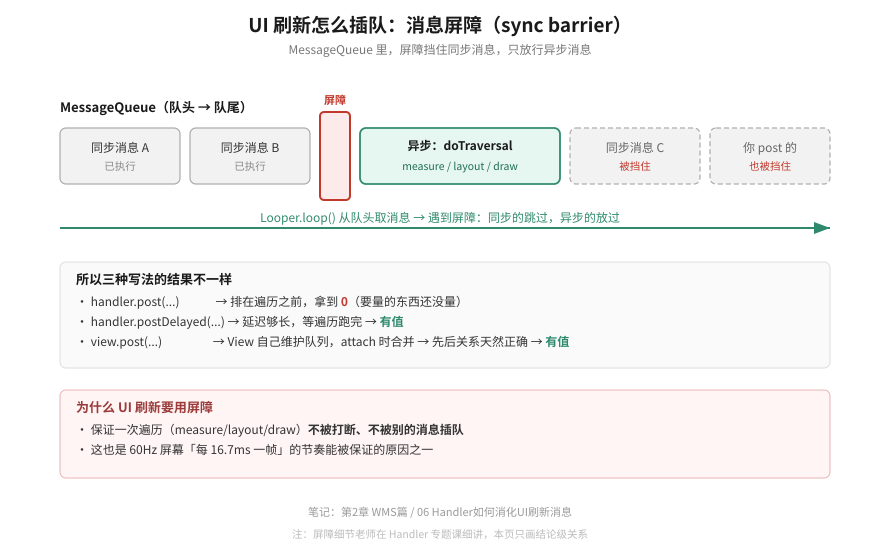

# 06 [Handler](../../../辅助稿/术语表.md#handler) 如何消化 UI 刷新消息

> **逐字稿**：`C:\Users\18369\Documents\ZhuangFengYuan\Android面试必问：AMS、WMS核心原理全解析\Android面试必问_AMS、WMS核心原理全解析 - P12 6.handler 如何管理和消化 UI刷新消息的.doc`
> 上一讲：[05 子线程能更新 UI 吗](05-子线程更新UI.md)｜下一讲：[07 绘制用的是同一个 Canvas 吗](07-绘制是否用同一个Canvas.md)
> 导读：[00 导读与规范](../00-导读与规范.md)
> **值得回看**：老师画消息队列（队头/队尾）、演示 `handler.post` 拿不到宽高而 `postDelayed` 能拿到，最后用 **`Looper` 的 Printer 接口**推演出"用消息耗时做性能监控"
> ⚠️ **文稿口误**：`MessageQueue` → 「max q / magic q」；`Looper` → 「loop / 撸p」；`ViewRootImpl` → 「view route」；`Printer` → 「print / 螺杆」

---

## 这一讲讲什么

上一讲留下两个谜：**`handler.post` 在 `onResume` 里为什么还拿不到宽高？`postDelayed` 为什么就行？**

答案是 **消息屏障（sync barrier）**。顺带把 "Handler 是 App 的心脏" 这条讲透，并推出一个**性能监控的实战方案**。

---

## 一、先立好地基：Handler 是 App 的心脏

### 1.1 为什么 App 不会自己退出

```java
// ActivityThread.main()
public static void main(String[] args) {
    Looper.prepare();       // 准备当前线程的 Looper（同时建 MessageQueue）
    ...
    Looper.loop();          // ★ 死循环，永不返回
}
```

| 事实 | 推论 |
|---|---|
| `Looper.loop()` 是个**死循环** | 它不返回 |
| `main()` 因此**永不结束** | **进程不会因为"程序跑完了"而退出** |
| 所以 App 会一直活着 | 除非 [AMS](../../../辅助稿/术语表.md#ams-atm) 把它杀掉 |

> **"Handler 只是线程通信"是错的** —— 它真正的身份是**让 App 活着的那个循环**。

### 1.2 一切都是消息

| 是什么 | 本质 |
|---|---|
| **每个生命周期** | 一条 `Message`（`handleLaunchActivity`、`handleResume`…） |
| **每次点击** | 一条 `Message` |
| **每次 UI 刷新** | 一条 `Message` |
| Fragment 生命周期 | 也是 `Message` |

> 所有消息按时间排进 **`MessageQueue`**：**队头先执行，队尾后执行**。

---

## 二、谜题：`onResume` 里 `handler.post` 为什么拿不到宽高



### 2.1 现象（老师现场跑的三种写法）

| 写法 | 能拿到宽高吗 |
|---|---|
| `handler.post(...)`（空消息/立即） | ❌ **0** |
| `handler.postDelayed(..., 延迟)` | ✅ **有值** |
| **`view.post(...)`** | ✅ **有值** |

### 2.2 关键：UI 刷新消息带**消息屏障**

`ViewRootImpl` 触发一次遍历不是普通消息：

```
scheduleTraversals()
   ↓
【先发消息屏障】            ← 把"同步消息"全部挡住
   ↓
post 一个 AsyncMessage → 里面跑 doTraversal（measure/layout/draw）
   ↓
遍历结束 【移除屏障】
```

| 概念 | 说明 |
|---|---|
| **消息屏障（sync barrier）** | 挡在队列某个位置，**让同步消息不能执行**，只放行**异步消息** |
| **谁用它** | UI 刷新（traversal）—— 保证刷新**不被别的消息插队** |

**所以**：

- 你的 `post` 消息是**同步消息** → 被屏障挡住 → 排在 traversal **后面**执行
- 执行到你的时候 traversal 已经跑完…**但为什么还是 0？**

> 老师给的解释：**`onResume` 的这条消息本身，和 traversal 之间还夹着"度量/布局"的消息**，你 post 的这条排在了它们**之前**的位置，此时 measure/layout **还没执行**，所以拿到的还是 0。
>
> 而 `postDelayed` 延迟足够长，等过了整个遍历，就有了值。

> ⚠️ 这部分老师点到"与消息屏障有关"，并明确说他**在 Handler 专题课里细讲**。笔记只保留结论级理解，**不要当完整定论**。

### 2.3 为什么 `view.post` 就行

> **`View.post` 内部有一套自己的队列**（还没 attach 时先攒着），在 attach 时**把消息合并进主线程的 handler 消息流**，因此**天然的先后关系是对的**（排在一次遍历之后）。

| 对比 | `handler.post` | `view.post` |
|---|---|---|
| 队列 | 直接用主线程 `MessageQueue` | **View 自己先攒，attach 时合并** |
| 结果 | 可能排在遍历前 → 0 | 排在遍历后 → 有值 |

---

## 三、把知识连起来：用消息耗时做性能监控（**面试加分题**）

### 3.1 需求

> 线上收集**每个 Activity 生命周期的耗时**，找出慢的那几次。

### 3.2 思路（老师的推演）

> **既然一切生命周期都是消息** → 那我只要**测量每条消息的执行耗时**，再挑出"和 Activity 生命周期相关"的就行了。

### 3.3 落点：`Looper` 自带日志钩子

```java
// 伪代码：Looper.loop() 里有这样的逻辑
if (logging != null) {
    logging.println(">>>>> Dispatching to " + msg.target + " " + msg.callback);
}
msg.target.dispatchMessage(msg);
if (logging != null) {
    logging.println("<<<<< Finished to " + msg.target + " " + msg.callback);
}
```

| 钩子 | 用途 |
|---|---|
| **`Looper.setMessageLogging(Printer)`** | 每条消息**开始/结束**都会回调 |
| 用**两条日志的时间差** | 就是这条消息的**执行耗时** |
| 从日志里能看出**它是什么消息** | 从而筛出 Activity 生命周期那几条 |

### 3.4 落地方式

```
App 启动时 → 给主线程 Looper setMessageLogging(自定义 Printer)
   ↓
Printer 收集每条消息的开始/结束时间
   ↓
筛出 Activity 生命周期消息 → 算出耗时
   ↓
上报到后端 → 找出慢的
```

> **腾讯的 Matrix**（Android 性能监控框架）用的就是这类机制 —— 老师专门提到它。

---

## 四、老师的延伸观点（值得记住）

| 观点 | 原话大意 |
|---|---|
| **知识要成体系** | 学得慢、学了就忘，根子是**没有体系**，不是不努力 |
| **正确的努力方向 > 努力程度** | 方向错了，再怎么努力也白费 |
| **性能优化的根** | OOM、卡顿、启动慢、布局、内存…**全都来自对 Framework / UI / Java 的理解** |
| **看源码的目的** | 不是"看完"，是**能解决线上问题** |

---

## 源码落点（行号直达）

| 环节 | 方法 | 位置 |
|---|---|---|
| **App 不退出的根源** | `Looper.loop()` 死循环 | [Looper.java:304 ↗](https://cs.android.com/android/platform/superproject/main/+/main:frameworks/base/core/java/android/os/Looper.java;l=304) |
| 消息入队 | `MessageQueue.enqueueMessage()` | [MessageQueue.java ↗](https://cs.android.com/android/platform/superproject/main/+/main:frameworks/base/core/java/android/os/MessageQueue.java) |
| **发屏障 + 投异步消息** | `ViewRootImpl.scheduleTraversals()` | [ViewRootImpl.java:2980 ↗](https://cs.android.com/android/platform/superproject/main/+/main:frameworks/base/core/java/android/view/ViewRootImpl.java;l=2980) |
| `view.post` 的自带队列 | `View.post(Runnable)` | [View.java:21316 ↗](https://cs.android.com/android/platform/superproject/main/+/main:frameworks/base/core/java/android/view/View.java;l=21316) ｜ [HandlerActionQueue ↗](https://cs.android.com/android/platform/superproject/main/+/main:frameworks/base/core/java/android/os/HandlerActionQueue.java) |
| 消息耗时统计的钩子 | `Looper.setMessageLogging(Printer)` | [Looper.java ↗](https://cs.android.com/android/platform/superproject/main/+/main:frameworks/base/core/java/android/os/Looper.java) |

> 想在 `Looper.loop()` 里验证"一切都是消息"：找 `logging.println(">>>>> Dispatching to ..."` 那一段 —— 每条消息进出都会打日志，这就是做性能监控能挂的钩子。

---

## 易错点

| 易错点 | 正确理解 |
|---|---|
| 以为 Handler 只是"线程通信" | 它是 **App 的心脏**：`Looper.loop` 死循环让进程不退出 |
| 以为所有消息按顺序排就完事 | UI 刷新会用**消息屏障**插队（只放行异步消息） |
| 以为 `handler.post` 一定在后面执行 | 可能排在遍历**之前** → 拿不到宽高 |
| 把 `handler.post` 和 `view.post` 混为一谈 | `view.post` 有**自己的队列**，attach 时合并 |
| 以为性能监控要改源码 | `Looper` 自带 **`setMessageLogging(Printer)`** 钩子 |

---

## 自检清单

> 用法：不查资料能说出/做到就打勾。勾不上的，箭头指向该去读哪一节。

- [ ] 能解释 `Looper.loop()` 的死循环和"App 不退出"的关系 → 1.1
- [ ] 能说出"一切都是消息"包含哪几类 → 1.2
- [ ] 能说出三种取宽高写法的实验结果 → 2.1
- [ ] 能说出**消息屏障的作用**以及谁在用它 → 2.2
- [ ] 能解释 `view.post` 为什么能拿到值 → 2.3
- [ ] 能设计出"用消息耗时监控 Activity 生命周期"的方案 → 三
- [ ] 能说出 `Looper` 上那个日志钩子的名字 → 3.3

---

## 一句话记忆

> **`Looper.loop()` 是死循环 → main 不返回 → App 不退出；生命周期/点击/刷新全是 Message，按 `MessageQueue` 排队。**
>
> **UI 刷新用「消息屏障」插队（只放行异步消息）→ `handler.post` 可能排在遍历前，拿到 0；`view.post` 有自己的队列，能拿到。**
>
> **一切皆消息 ⇒ 给 `Looper` 设 `Printer` 统计每条消息耗时，就能做 Activity 生命周期监控（Matrix 同款思路）。**
